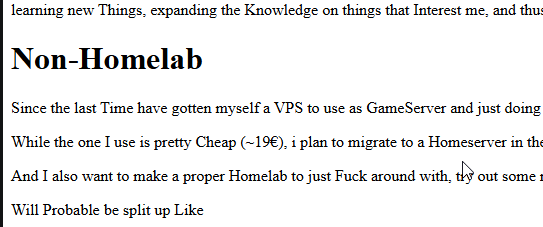

<body>
    

        <h1>First Order of the Day: Following your Brain</h1>
        
Some People say to follow your Heart. I like to follow my Brain. 

        
Ok, that may sound like im making fun of them hear me out though. I like Nourishing my Brain, learning new Things, expanding the Knowledge on things that Interest me, and thus is everso rarely go on google
        and look up Names of People in the Computer Science / Software Development Areas

    

    

        <h1>Non-Homelab</h1>
        
Since the last Time have gotten myself a VPS to use as GameServer and just doing random stuff

        
Like Playing around with setting up my own EMail, which kinda failed because I did not care enough about it
            to set up the whole signing thing so that ended pretty quicky.

        
While the one I use is pretty Cheap (~19€), i plan to migrate to a Homeserver in the Future since it will
            probably have much more Performance and Storage, and i don't Plan to Pay someone 20 Bucks for the Rest of my
            life to Rent an ok Server.

        
And I also want to make a proper Homelab to just Fuck around with, try out some networking and stuff.

        
Will Probable be split up Like 

        

            <h4>"Production" Server</h4>
            Everything Running in Docker( Pterodactyl Panel / Git Server / CI/CD Pipeline / Local DNS Server / Outgoing
            Webserver maybe? / Personal Website) Pterodactyl Game Server
        

        

            <h4>Development / Test Server</h4>

            Things go here before i deploy anything
            This will probably have a big Red Button labeled RESET cause this will break a lot
        

    

    

        <h2>Personal Interests: One-Piece / Anime / Things to watch</h2>
        
Who would have thought, i like One-Piece.

        
Not so long ago i actually "finished" the Anime. At least what is there to finish.

        
I found it really Surprising that it took Toei so long to Actually invest in Proper animation for it. I've
            heard the main Reason why its Style looked so "Old" for so long is because Toei (The Animaton Studio for
            One-Piece) capped its Budget and the only Reason it improved was because Oda (The Writer and Creator of One
            Piece) pressured them.

        
Could as well just have been some random Redditor who pulled some Random Story out their Ass

        
Now im getting the Itch again

        
Especially since the Dr.Who 2026 Christmass Special has been Cancelled so currently i have nothing to watch.
        

        
Well, i say nothing. I'm currently Watching Baki, but more as a thing to fill the Gap than actuall Interest.
            And if im not Watching Baki, i watch Youtube, but it's so hard do find some good Long Form Video Essays
            somehow.

    

    

        <h1>Mining Gems: Ruby</h1>
        
I've been reeding this Blog: https://sites.google.com/site/steveyegge2/tour-de-babel?pli=1&authuser=0 and out
            of all languages Ruby stuck out the most for me. Why? Well i never wrote in it, saw its Syntax or interacted
            with it in any way, other thant that i've heard of it, like Rust.

        
So i startet taking a look on its Website, and i have to say, im impresed, just the examples on its Homepage
            are very intereseting

    

    <h2>Personal Interests: GTA 6</h2>
    
It's finally coming out, and i Pre-Ordered, just the normal Edition though, the Special one does not look worth
        it. Especially that Goodies Pack that costs like 300 Euros (didn't check), i find the Price for the Amount of
        stuff it has and no game included outrageous, but Consumers gonna Consume.

    
Funnily enough, its release might make a Visible dip in the Stock market, since it is Estimated to have the most
        Amount of Vacation taken in a long time

    
I might just be talking complete and utter nonsense, im not a Economist after all, or whatever they call it.

    <h2>Personal Interests: Emulation, Reverse Engineering and Piracy</h2>
    
For a few years now i've taken Interesst in Emulation, Reverse Engineering and Piracy. Alone the abiity to run
        Software on PC or other Consoles, even though it is not made to run on them is just spectacular for me.

    
And with AI beeing on its Absolute high in Development right now, recompilation has become a thing People take
        into consideration, since Modern Console are no longer built for the Job but just fancy Slimmed down Computers
        with Semi-Custom Operating Systems, relinking is as easy as ever, Relatively Speaking. I'm looking at 2 Projects
        Specifically <a href="">AnyPS5
 and <a href="https://github.com/zortos293/Lichii/tree/nx2">Lichii</a>.

    <h3>AnyPS5</h3>
    
Previously, the only time i've even heard of Static Binary Relinking was in the Context of Linx-Windows
        Compatability, and even then, the extend of my knowledge reached the point where i know it wasn't really a good
        Option for Cross-Platform Software Solutions.

    
During the Uproar of AnyPS5 i got wind of it, and was astounded. I mean PS5 native games running on PC without
        having the Source Code? Sounds like a Dream to me, but here we are.

    
The only Reason the Project moves so fast, to my knowledge, is the Absolute hate People fell to Big Anti-Consumer
        Corperations like Sony. And i kinda love that.

    <h3>Lichii</h3>
    
Since it's Announcement, People thought the Switch 2 was uncrackable. The long Streak of Nintendo Console
        Emulation has ended and thats's it. 

     
    
And then a Wonder is brought into this World

    
Eden-NX2, the first ever NS2 Emulator was released on Github and it was amazing

    
But personally im more interested in Lichii and Fritchii. Lichii is Multi-Platform fork of Eden-NX2, but the most
        interesting out of all in my opinion is Fritchi, a Lichii Fork specificaly made for the "The Legend of Zelda:
        Ocarina of Time" remake. Since it has so many issues with the normal Emulators.

    
I have nothing else to say about this other than that i find it all very interesting. Im not very deep in the
        actual tech of Emulating

    <h2>Additional Notes</h2>
    <h3>Plain HTML</h3>
    
Kinda liking the Plain HTML look

    

    

        
Disclaimer

        
Any and every piece of Text or Code, unless specified otherwise is 100% written and tought of by a Human.
             
            Sad that that has to be specified

    

</body>
